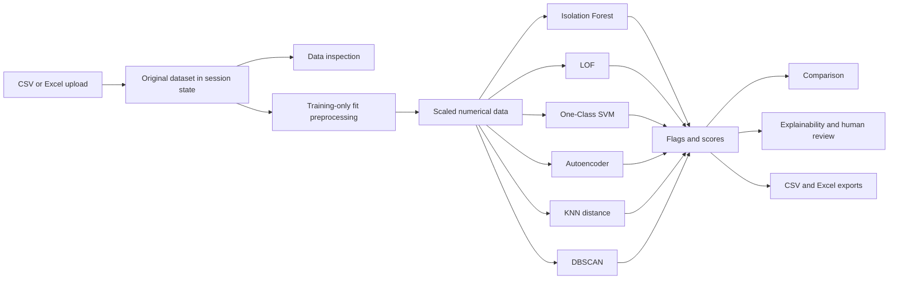

# Healthcare Anomaly Detection System

A final-year B.Tech project comparing six unsupervised machine-learning
methods for detecting records that require data-quality review.

The application is a real pipeline: uploaded records remain unchanged,
selected features are processed separately, and every algorithm executes
against the processed numerical data.

## Recommended environment

- Python 3.11
- Windows PowerShell
- A virtual environment

## Install

```powershell
py -3.11 -m venv .venv
.venv\Scripts\Activate.ps1
python -m pip install --upgrade pip
python -m pip install -r requirements.txt
```

## Run

```powershell
streamlit run app.py
```

Open `http://localhost:8501`.

## Synthetic demonstration data

`data/sample/synthetic_healthcare_demo.csv` is clearly synthetic and is not
real patient data. It demonstrates the workflow; do not use it for clinical
validation or as evidence of real-world performance.

## Workflow

1. Upload CSV or Excel data.
2. Inspect dimensions, types, missing values, duplicates and constant columns.
3. Select numerical features.
4. Apply median/mean/most-frequent imputation and standard/robust scaling.
5. Run Isolation Forest, LOF, One-Class SVM, Autoencoder, KNN distance or DBSCAN.
6. Review alerts, distributions, overlaps and flagged records.
7. Download processed data and combined results.

## Architecture



## Algorithm interpretation

| Algorithm | Meaning of a high score or flag |
|---|---|
| Isolation Forest | Easier to isolate from the rest |
| LOF | Low local density relative to neighbours |
| One-Class SVM | Outside the learned normal boundary |
| Autoencoder | High reconstruction error |
| KNN distance | Far from a configured kth neighbour |
| DBSCAN | Assigned to noise rather than a dense cluster |

## Evaluation

Metrics are calculated only when a verified binary label column is explicitly
selected. `1` means an anomaly and `0` means a normal record. Available metrics
include precision, recall, F1, specificity, false-positive rate, PR-AUC,
ROC-AUC and the confusion matrix.

## Limitations

- No universal best algorithm.
- Results depend on features, preprocessing and parameters.
- Anomaly alerts are not diagnoses.
- The app does not fabricate missing datasets or ground-truth labels.
- State-held-out validation requires a verified state identifier and
  record-level data.

## Important use constraint

This tool identifies records that warrant further review. It does not diagnose
disease, identify medical emergencies, or determine whether a record is
incorrect.

